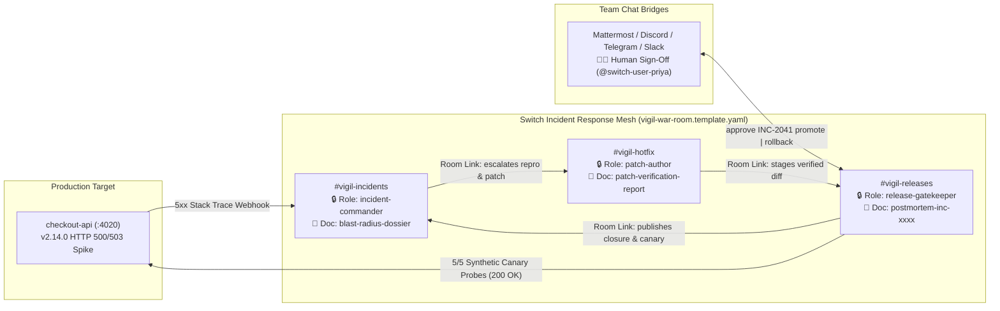

# ⚡ Vigil — Autonomous Incident-to-Hotfix War Room on Switch

> **Built for the [Flip the Switch Hackathon](https://www.wemakedevs.org/hackathons/switch) (Track 01: Best Business Workflow)**  
> Turn production outages into coordinated, human-governed team workflows across linked **Switch Rooms** in **Mattermost, Discord, Telegram, or Slack** — powered by the **Switch WebSocket Agent Protocol**, **Switch v1 Group Templates**, and **CLI Coding Agents** (Claude Code / Antigravity / Codex).

---

## 🎯 Why Vigil Needs Switch (And Stops Working Without It)

During a SEV-1 production outage, context fractures across terminals, PagerDuty alerts, solo coding agents, and chat threads:
- One engineer's solo coding agent fixes a bug locally with zero visibility for the on-call lead.
- Nobody knows who holds Incident Command or whether a candidate patch passed edge-case verification.
- Autonomous agents with deploy credentials risk pushing unreviewed fixes straight to production.

**Vigil encodes the entire incident-to-hotfix lifecycle directly into Switch's room primitives:**



### Nothing Is Mocked
| Layer | What actually runs |
|---|---|
| **Target service** | [`services/checkout-api`](./services/checkout-api) is a real Node/TypeScript HTTP service with its own source, `node:test` suite and release patches. Vigil copies it into a **git-backed working copy** (`.vigil-state/checkout-api-live-4020`, tag `v2.13.2`) and runs it as a **child process** on `:4020`. |
| **Regressions** | *Chaos* = `git apply` a real release patch, commit it with the offending author/message, bump `VERSION` to `v2.14.0`, **restart the process**. The 500/503s are real exceptions from the new code. |
| **Telemetry** | A built-in synthetic traffic generator sends real mixed-currency checkouts; the service measures error rate and p99 over a 60s window and exposes `/metrics`. On its first 5xx per version it POSTs a **real alert webhook** that opens the incident. |
| **Patching** | Auto mode: `vigil-patcher` does a real `git revert` of the regression commit. External mode: your coding agent edits the working copy or posts a diff that is applied with `git apply`. Either way the candidate is **committed, tested with the service's real test suite, booted on a staging port, and replayed with the production payload**. Red candidates are discarded with `git reset --hard`. |
| **Release** | Promote = restart the process from the verified candidate commit. Rollback = `git reset --hard v2.13.2` + restart. Canary = 5 real HTTP probes. The Observatory shows the live `git log` and the service `pid` changing on every deploy. |
| **Seeded** | Only the three regression patches, and the embedded spec-exact Switch protocol server used in Mode A (Mode B connects to a real Switch Console server). |

### What Makes Vigil Different
| | Feature | Switch primitive doing the work |
|---|---|---|
| 🤝 | **Your coding agent is the patcher.** Flip `patcher` to *external* and `@vigil-sentinel` hands the incident to the Claude Code / Codex session you bound into `#vigil-hotfix` via Switch Console ([`CLAUDE.md`](./CLAUDE.md) briefs it). `@vigil-patcher` steps back into `red-team-verifier`, reproduces independently, runs the regression matrix on *the diff your agent actually wrote*, and rejects anything that doesn't carry the fix. | role leases (`patch-author` vs `red-team-verifier`), `post_message` diff hand-off, `create_room_document` |
| 📜 | **Release policy lives in a Switch room document, not in code.** The gate re-reads `release-safety-policy` on every approval. Priya types `@vigil-release-gate set max diff 4` or `set approvers sam` in chat and the next approval is judged by the new rules. Agents trying to edit policy are blocked. | `load_internal_documents`, `update_room_document`, human-only authorship |
| ♻️ | **Incident-commander failover.** Click *Crash Sentinel* mid-incident: the socket stays open but stops answering pings. *Failover Sentinel* reopens the **same `connection_id`** from the last cursor; the server evicts the wedged client with `evicted: taken_over` (final), the new generation resumes without gaps and re-asserts the exclusive `incident-commander` lease. | WebSocket generation fencing, `taken_over`, cursor resume, exclusive `assume_role` |
| 📦 | **Rooms as lifecycle objects.** Every incident gets an ephemeral `#hotfix-inc-xxxx` red/blue workroom instantiated from [`templates/vigil-hotfix-workroom.template.yaml`](./templates/vigil-hotfix-workroom.template.yaml), linked from `#vigil-hotfix`, and archived at closure. | `create_room`, `link_rooms`, `archive_room` |

### Native Switch Primitives Used End-to-End
1. **Switch v1 Group & Room YAML Templates ([`templates/vigil-war-room.template.yaml`](./templates/vigil-war-room.template.yaml)):** Provisions all 3 rooms, 3 agents (`allow_existing: true` + managed coding provider fallback `[claude, antigravity, codex, opencode, cursor]`), exclusive roles, room documents, service references, aliases, kickoffs, and directed room links in one click.
2. **Custom Switch WebSocket + HTTP Agent Protocol SDK ([`src/protocol/switchClient.ts`](./src/protocol/switchClient.ts)):**
   - Connects over `GET /agents/{agent_id}/connection/ws` (not deprecated SSE) with `Authorization: Bearer`.
   - Answers every 2-second `ping` control frame synchronously with `{"type": "pong", "cursor": n}` so the 6-second heartbeat TTL never lapses during test runs.
   - Implements `connection_state` generation fencing (`expected_generation` + `start_from`), `gap` recovery via `read_context`, and terminal halt on `evicted: taken_over`.
   - Dynamically discovers operations via `GET /agents/{id}/ops` and invokes `POST /agents/{id}/ops/{op}` with `X-Switch-Connection-Id`.
3. **Exclusive Role Leases (`assume_role` / `release_role`):** Single-writer leases on `incident-commander`, `patch-author`, and `release-gatekeeper` prevent conflicting concurrent actions.
4. **Room-Scoped Documents (`create_room_document` / `update_room_document`):** Agents publish `blast-radius-dossier`, `patch-verification-report`, and `postmortem-inc-xxxx` with enforced Switch document authorship.
5. **Directed Room Links (`list_linked_rooms`):** Agents dynamically discover the next room in the pipeline rather than hardcoding channel IDs.
6. **Deterministic Zero-LLM Human Release Gate ([`src/gate/releaseSafetyGate.ts`](./src/gate/releaseSafetyGate.ts)):** Strictly rejects `@switch-agent-*` self-approvals or prompt-injected messages — only a verified `@switch-user-*` human teammate in chat can authorize `promote` or `rollback`.

---

## 🚀 Quickstart (2 Ways to Run)

### Mode A: Instant 1-Command Clone & Reproduce (Zero External Setup)
Vigil includes an embedded **Spec-Exact Switch Protocol Server** (`src/mock-switch/switchServerHarness.ts`) alongside the live `checkout-api` microservice and the **Vigil War Room Observatory UI**, so judges can verify the full WebSocket protocol and workflow in 30 seconds:

```bash
git clone https://github.com/mrnetwork0001/Vigil.git
cd Vigil
npm install
npm test
npm run build
npm start
```

Open **`http://localhost:4010`** — this is the **Vigil landing page** (problem, 3-room pipeline, Switch primitives, 4-click demo, quickstart). Click **Launch App** to enter the live **War Room Observatory** at **`http://localhost:4010/app`**, then:
1. Click any **Chaos release** button (`01 JPY Zero-Decimal 500`, `02 Stacked Promo Negative 500`, or `03 Inventory Lock Leak 503`).
2. Watch `@vigil-sentinel` → `@vigil-patcher` → `@vigil-release-gate` collaborate across `#vigil-incidents`, `#vigil-hotfix`, and `#vigil-releases` over real WebSockets, inspect the live **WS Protocol Frames**, and read the generated **Room Docs**.
3. Click **Test Rogue Agent Block** to see the deterministic safety gate block an AI agent trying to approve its own release (`REJECTED_AGENT_SENDER`).
4. Click **Approve & Promote as Priya** (or type `@vigil-release-gate approve INC-2041 promote` in the chat bar) to promote `v2.14.1-hotfix`, run 5 real HTTP synthetic canary probes against `http://localhost:4020/api/checkout`, and generate the blameless postmortem!
5. **Go further:**
   - Set **Patch author** to **@claude-code** in the control bar, trigger a scenario, and use the **External patch intake** panel (Patch & Canary tab) to hand a diff to `@vigil-patcher`. Try **Load bad diff** first to watch the verifier reject it, then **Load reference fix**.
   - In `#vigil-releases` send `@vigil-release-gate set max diff 1`, then approve: the gate rejects the patch with `REJECTED_DIFF_POLICY_VIOLATION` because the room document now says so. `set max diff 60` and approve again.
   - Mid-incident, click **Crash Sentinel** then **Failover Sentinel** and watch the **WS Protocol** tab for `evicted: taken_over` and the new generation re-asserting `incident-commander`.
   - Watch `#hotfix-inc-2041` appear in the room list when an incident opens and flip to *archived* when it closes.

---

### Mode B: Live Switch Console + Bundled Mattermost / Discord / Telegram Bridge
Connect Vigil's WebSocket protocol agents directly into your live **Switch Console** server alongside **Claude Code** or **Antigravity**:

1. **Install & Start Switch Console (macOS Apple Silicon / Intel):**
   ```bash
   chmod +x scripts/install-switch-console.sh
   ./scripts/install-switch-console.sh
   ```
   Open **Switch Console** → **Get started** → **On this computer** → **Start** (starts local Switch Server + bundled **Mattermost** in Docker). Optionally connect **Discord** or **Telegram** under Messaging Apps.

2. **Create a Registration API Key in Switch Gateway:**
   Open the Switch Gateway → **API Keys** → create a key of type `registration`.

3. **Onboard Vigil's 3 WebSocket Agents (`POST /agents`):**
   ```bash
   SWITCH_SERVER_URL=http://localhost:8000 \
   SWITCH_REGISTRATION_KEY=sw_reg_your_key_here \
   npm run onboard:switch
   ```

4. **Import the Official Group Template in Switch Console:**
   - Open **Switch Console** → **Templates** → **Import template** → select [`templates/vigil-war-room.template.yaml`](./templates/vigil-war-room.template.yaml).
   - Click **Use template**, choose your **Mattermost / Discord / Telegram** bridge, and select **Existing agent** on the cards (or bind `vigil-patcher` directly to your local **Claude Code** / **Antigravity** session pointed at `/Users/mrnetwork/Vigil` — [`CLAUDE.md`](./CLAUDE.md) briefs it automatically!).

5. **Launch Vigil Connected to Your Live Switch Server:**
   ```bash
   npm run dev
   ```
   Trigger a real fault from a second terminal (`npm run inject:fault jpy_zero_decimal_500`) and approve the release right inside **Mattermost / Discord / Telegram**!

---

## 🧪 Automated Verification Suite

Run the full Vitest integration & security suite:

```bash
npm test
```

Tests verify:
- External coder routing: verifier seat, rejection of a non-fixing diff (`422`), acceptance of a chat-posted ```` ```diff ```` fence, ephemeral workroom creation/linking/archival.
- Room-document policy: agent policy edits blocked, human `set max diff 4` rejects promotion, `set approvers sam` rejects Priya with `REJECTED_UNAUTHORIZED_APPROVER`.
- Commander failover: wedged sentinel evicted with `taken_over`, standby resumes on the same `connection_id` from the last cursor with a new generation and the lease intact.
- Official Switch v1 YAML Group & Room template schema compliance (`templates/*.yaml`).
- WebSocket `/agents/{id}/connection/ws` handshake, `connection_state`, 2s `ping`/`pong` cursor liveness, `409` duplicate registration guard, and `taken_over` terminal eviction fencing.
- Exclusive role lease contention (`409` until `release_role`) and room-scoped document authorship enforcement (`403` on cross-agent overwrite).
- End-to-end incident triage → reproduction & 5-vector regression matrix → deterministic block of rogue agent self-approval (`REJECTED_AGENT_SENDER`) → human promotion (`v2.14.1-hotfix`) & emergency rollback (`v2.13.2`) with 5/5 live HTTP canary probes.

---

## 📂 Repository Structure

```text
Vigil/
├── templates/
│   ├── vigil-war-room.template.yaml        # Official Switch v1 3-room Group Template
│   └── vigil-hotfix-workroom.template.yaml # Ephemeral per-incident Red-Blue Workroom Template
├── src/
│   ├── protocol/
│   │   ├── types.ts                        # Switch Agent Protocol wire & resource types
│   │   └── switchClient.ts                 # WebSocket + HTTP Ops Switch Agent Client SDK
│   ├── agents/
│   │   └── vigilMeshCoordinator.ts         # Sentinel, Patcher & Release Gate multi-room logic
│   ├── gate/
│   │   └── releaseSafetyGate.ts            # Zero-LLM deterministic human sign-off safety gate
│   ├── services/
│   │   └── checkoutTarget.ts               # Git-backed working copy + child process + real verify/deploy
├── services/
│   └── checkout-api/                       # The real target service: src/, test/ (node:test), releases/*.patch
│   ├── mock-switch/
│   │   └── switchServerHarness.ts          # Spec-exact Switch bridge for instant CI & local runs
│   └── index.ts                            # Dual-mode runtime & Observatory server (:4010)
├── ui/
│   ├── Landing.tsx                         # Marketing landing page (/) with "Launch App" CTA
│   ├── App.tsx                             # Live War Room & WS Frame Observatory (/app)
│   └── main.tsx                            # Path router: / -> Landing, /app -> War Room
├── scripts/                                # Switch Console installer, agent onboarding & fault CLI
├── tests/                                  # End-to-end protocol, chaos & safety gate tests
├── .mcp.json                               # Pre-wired to https://docs.switchagents.ai/mcp
└── CLAUDE.md                               # Briefing for Switch Console Claude/Antigravity agents
```

## 📄 License
MIT — see [`LICENSE`](./LICENSE).
