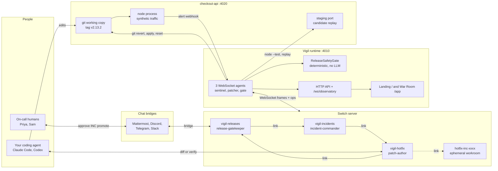
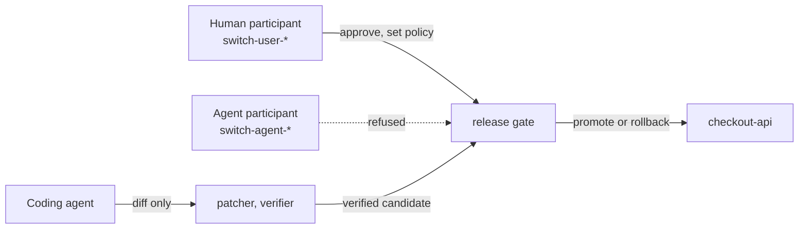
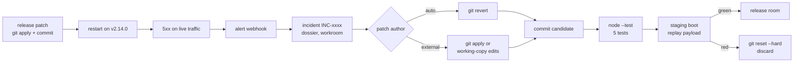
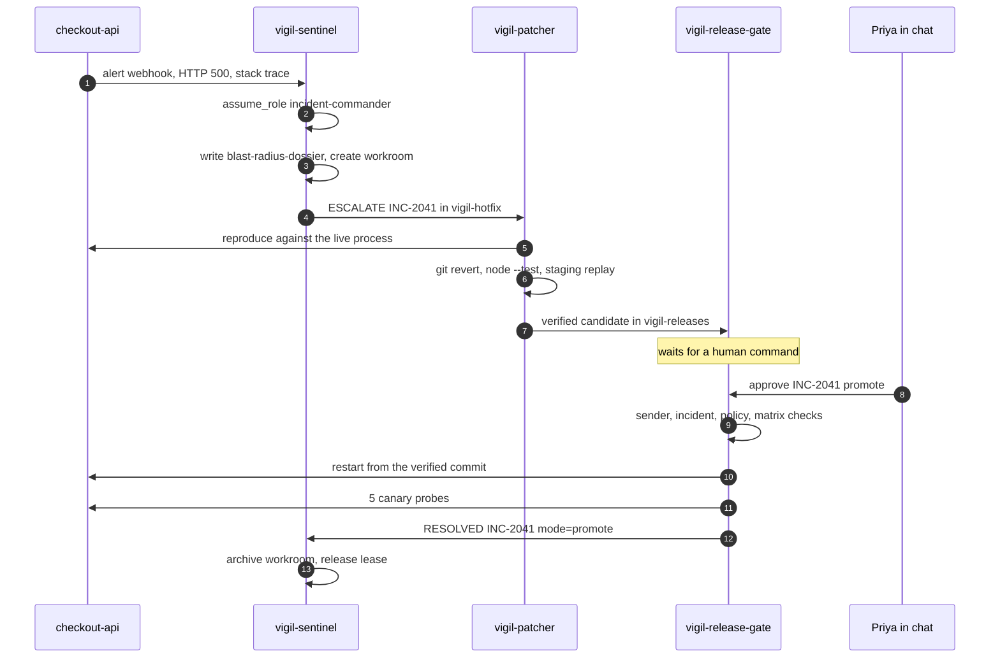
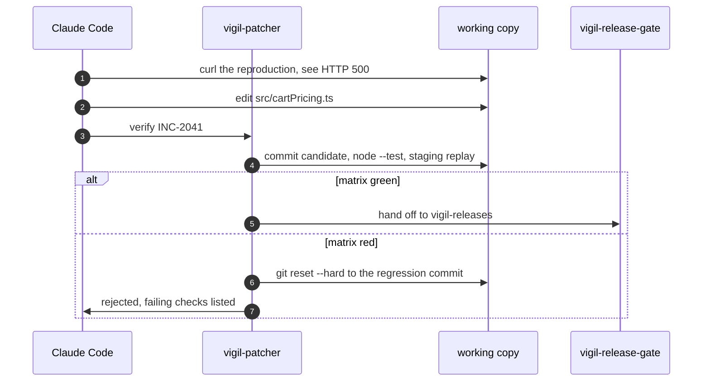
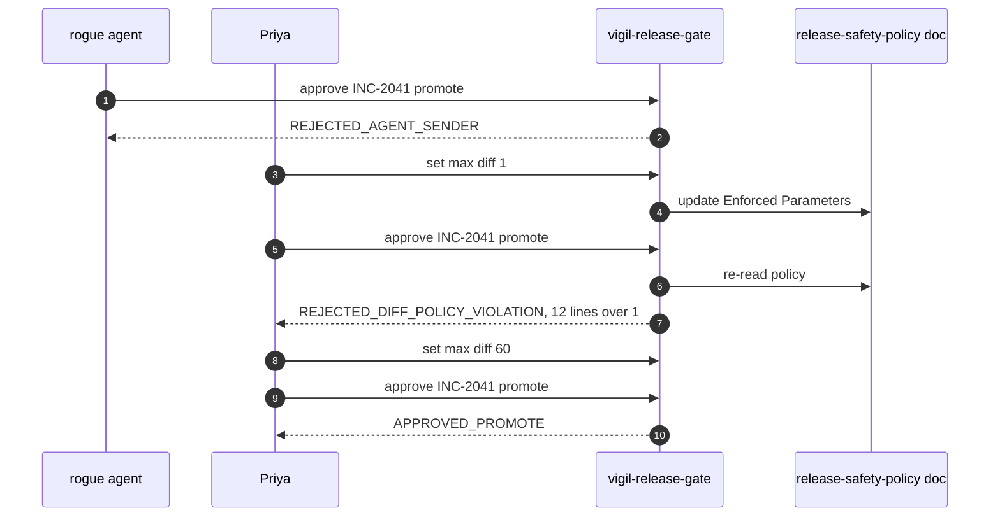
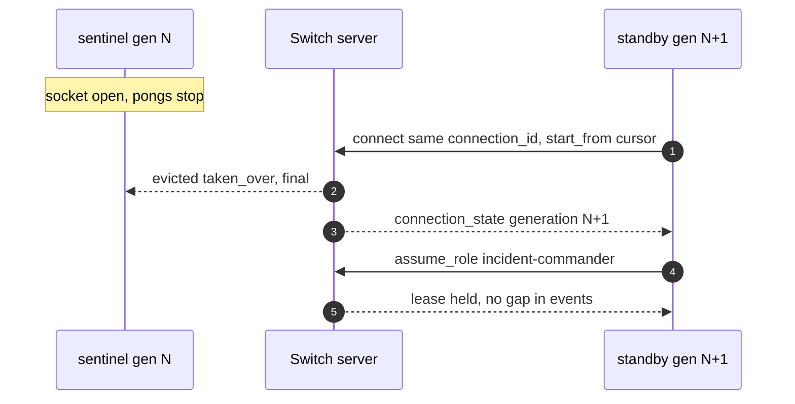
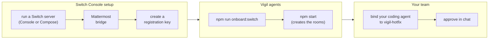

# Vigil

**Vigil runs a production outage across three linked Switch rooms: agents find and fix the bug, and only a human can ship the fix.**

When a release breaks checkout, `@vigil-sentinel` takes command in `#vigil-incidents`, a patcher (Vigil's own, or your Claude Code session) writes the fix in `#vigil-hotfix`, and `@vigil-release-gate` waits in `#vigil-releases` until a teammate types `approve INC-2041 promote` in Mattermost, Discord, Telegram or Slack. Everything is measured by one rule: **no change reaches production unless the real test suite is green, the failing request now succeeds on staging, and a human said yes.**

Built for the [Flip the Switch Hackathon](https://www.wemakedevs.org/hackathons/switch) (WeMakeDevs x Switch, Track 01: Best Business Workflow) · Live: [vigil.netlayerlabs.com](https://vigil.netlayerlabs.com), on a real Switch server · Local: [Run it](#run-it-locally) · Demo: `<VIDEO_URL>` · Code: [github.com/NetLayerLabs/Vigil](https://github.com/NetLayerLabs/Vigil)

**Judges, start here:** `npm install && npm run build && npm start`, open [localhost:4010](http://localhost:4010) and press **Open the War Room**. No accounts, keys or Docker are needed: Vigil boots its own Switch protocol server and a real checkout service. Click **01 JPY Zero-Decimal 500**, wait about 5 seconds for the dark sign-off bar, then click **Approve & Promote as Priya**. The whole incident takes under a minute.

**Or watch it live:** [vigil.netlayerlabs.com/app](https://vigil.netlayerlabs.com/app) runs the same agents against a real Switch server (0.31.0) with Mattermost. Ship a chaos release there and the rooms, roles and documents you see are the server's own. On the live site the page cannot approve anything: a human approves in Mattermost, and **Test Rogue Agent Block** posts a real approval from the patcher agent so you can watch the gate refuse it.

---

## The loop: four moves, no setup needed

| Move | What it is | Try it locally |
| --- | --- | --- |
| **Break** | Vigil commits a real regression to a git working copy of `checkout-api`, under the offending author and message, and restarts the service on `v2.14.0`. The 500s and 503s come from the new code. The service posts its own alert webhook on its first 5xx (server error). | `/app` → **Chaos release**: `01 JPY Zero-Decimal 500`, `02 Stacked Promo Negative 500` or `03 Inventory Lock Leak 503` |
| **Command** | `@vigil-sentinel` assumes the exclusive `incident-commander` role in `#vigil-incidents`, writes the `blast-radius-dossier` room document with the exception, suspect commit and file:line, and follows the room link to `#vigil-hotfix`. An ephemeral `#hotfix-inc-2041` workroom is created and linked. | Watch the **Room** log and the left rail's role leases |
| **Fix and verify** | Auto mode: `@vigil-patcher` runs a real `git revert`. External mode: your coding agent edits the working copy or posts a diff, applied with `git apply`. Either way the candidate is committed, the service's real `node --test` suite runs, and the candidate boots on a staging port and replays the failing production request. *A diff that does not carry the fix never reaches the release room.* | **Patch** tab: candidate diff, 6-row matrix, raw TAP (Test Anything Protocol) output. **Patch author → @claude-code** then **Load bad diff** to see a rejection |
| **Ship** | `@vigil-release-gate` is deterministic code, not a model. It refuses agent senders, checks the incident ID, re-reads the release policy from a room document, then promotes (restart from the verified commit) or rolls back (`git reset --hard v2.13.2`). Five live HTTP canary probes follow, then a postmortem document. | **Test Rogue Agent Block**, then **Approve & Promote as Priya** or **Rollback to v2.13.2** |

### More to explore

| Feature | What it is | Where |
| --- | --- | --- |
| **Policy edited from chat** | The gate's limits live in the `release-safety-policy` room document. A human types `@vigil-release-gate set max diff 1` and the next approval is rejected with `REJECTED_DIFF_POLICY_VIOLATION`. `set approvers sam` makes Priya's approval fail with `REJECTED_UNAUTHORIZED_APPROVER`. An agent sending the same command is refused. | Chat chips in `/app`, or type them in `#vigil-releases` |
| **Commander failover** | **Crash Sentinel** wedges the incident commander: its socket stays open but stops answering pings. **Failover Sentinel** reopens the same `connection_id` from the last cursor; the server evicts the old client with `evicted: taken_over`, and the new generation re-asserts the `incident-commander` lease. | Drawer or control bar in `/app`, then the **Protocol** view |
| **Per-incident workrooms** | Each incident gets `#hotfix-inc-xxxx` from [`templates/vigil-hotfix-workroom.template.yaml`](templates/vigil-hotfix-workroom.template.yaml), linked from `#vigil-hotfix` and archived at closure. | Left rail: tagged *workroom*, then *archived* |
| **Bring your own coding agent** | [`CLAUDE.md`](CLAUDE.md) briefs Claude Code, Codex, Cursor, OpenCode or Antigravity as the `patch-author`: reproduce with `curl`, edit the live working copy, run the tests, hand off by `verify INC-xxxx`, a diff fence in chat, or `POST /api/incidents/INC-xxxx/stage-patch`. | [`CLAUDE.md`](CLAUDE.md) |
| **Switch group template** | One YAML file provisions the three rooms, three agents, exclusive roles, room documents, a service reference and directed links in Switch Console. | **Switch template** button in `/app` · [`templates/vigil-war-room.template.yaml`](templates/vigil-war-room.template.yaml) |
| **Protocol inspector** | Every WebSocket frame and operation call the agents make: `connection_state`, `ping`/`pong` cursors, `message`, and `POST /ops/*` with `X-Switch-Connection-Id`. | **Protocol** view in `/app` |
| **Alerts from your monitoring** | Prometheus Alertmanager, Sentry (with its webhook signature) or any JSON source can raise the incident, instead of the service's own alert. | `POST /api/webhooks/{alertmanager,sentry,generic}` |
| **Guard your own service** | A target manifest describes the service: a folder or git URL, its release tags, start and test commands, health check, endpoint, traffic and canaries. | [`targets/README.md`](targets/README.md) |

The app has two pages. `/` is the landing page, which reads live status from `/api/state` (deployed version, error rate, p99 latency, agents online, the policy currently in force, and the real `git log`). `/app` is the War Room: rooms and agents on the left, the selected room's log in the middle, and documents, protocol frames and patch evidence on the right. Every page works on phones: at 900px and below the left rail becomes a drawer, and a Room / Docs / Protocol / Patch switcher shows one view at a time while the sign-off bar stays on screen.

## Why Switch is essential

Take Switch away and Vigil has no place to work, no way to hand off, and no one in charge.

- **No rooms, no workflow.** Triage, fix and release are three Switch rooms joined by directed links. Agents find the next room with `list_linked_rooms`; no channel ID is hard-coded (`src/agents/vigilMeshCoordinator.ts`).
- **No role leases, no command.** `incident-commander`, `patch-author` and `release-gatekeeper` are exclusive `assume_role` leases. A second claimant gets `409` until `release_role`, so two agents can never ship at once (`src/mock-switch/switchServerHarness.ts`, test *role leases*).
- **No room documents, no policy.** The gate reads its rules from the `release-safety-policy` document on every decision, and Switch's document authorship check stops one agent overwriting another's report (`403`). See `src/gate/releaseSafetyGate.ts`.
- **No bridged chat, no human.** Approval is a chat message the Switch server marks as from a person (`sender_kind: user`), so the person who signs off is in Mattermost, Discord, Telegram or Slack, not in Vigil's UI.
- **No generation fencing, no failover.** Commander takeover relies on Switch's `connection_state` generations, `start_from` cursors and the final `evicted: taken_over` frame (`src/protocol/switchClient.ts`).

## Architecture

Vigil has four layers:
- **The rooms:** a Switch server holds rooms, roles, documents and links. Locally that is Vigil's embedded protocol server (Mode A); otherwise a real Switch server (Mode B), such as the live deployment at `vigil-switch.netlayerlabs.com`.
- **The agents:** three WebSocket agents (`vigil-sentinel`, `vigil-patcher`, `vigil-release-gate`) plus, optionally, your coding agent.
- **The target:** a real Node service, `checkout-api`, run as a child process from a git working copy.
- **The War Room:** one Node HTTP server on `:4010` serving the API, a live WebSocket feed and the React UI.

### System overview



The agents are ordinary Switch clients: they connect to `GET /agents/{id}/connection/ws`, answer every `ping` with a `pong` carrying their cursor, and call operations over HTTP. The War Room reads state and posts chat only as a human participant (`@switch-user-*`); its *Test Rogue Agent Block* button posts as a user whose name copies an agent's, to prove the gate sees through it. The checkout service never knows Vigil exists beyond the webhook URL it is given.

### Who can do what



| Identity | Lives in | Can | Can never |
| --- | --- | --- | --- |
| Human teammate (`@switch-user-*`) | Chat bridge or the War Room chat bar | Approve `promote` or `rollback` for the active incident, edit the release policy from chat | Promote a candidate whose matrix is red or whose diff breaks the policy |
| `vigil-sentinel` | Vigil runtime | Hold `incident-commander`, write the dossier, open and archive the workroom | Approve a release (`REJECTED_AGENT_SENDER`) |
| `vigil-patcher` | Vigil runtime | Revert, apply and test candidates, write `patch-verification-report` | Approve a release, edit policy, or skip the test suite |
| `vigil-release-gate` | Vigil runtime | Restart the service from a verified commit, reset to `v2.13.2`, run canaries | Act without a human command that names the active incident |
| External coding agent | Your terminal, bound through Switch Console | Edit the working copy, post a diff, ask for verification | Promote, roll back, or take `release-gatekeeper` (see [`CLAUDE.md`](CLAUDE.md)) |

### From a bad release to a verified candidate



The matrix has six rows: the service's five `node --test` cases and the staging replay of the exact request that failed in production. A red candidate is thrown away with `git reset --hard` back to the regression commit, so the next attempt starts clean.

### One incident, end to end



Every handoff between two participants is a real chat message in a Switch room, delivered over WebSocket only to the agents it addresses; the self-arrows are Switch operations such as `assume_role` and `create_room_document`. The sentinel closes the incident only after the gate reports the canary result.

### An external coding agent hands off a fix



The same verification runs for a diff posted in a chat fence or sent to `POST /api/incidents/INC-xxxx/stage-patch`, which answers `200` when verified and `422` with the failing checks when not.

### The gate refuses, then a human decides



The gate checks, in order: agent sender, command grammar, incident ID, approver allow-list, then for `promote` a confirmed reproduction with a green matrix, then the diff size and forbidden paths. `rollback` to `v2.13.2` skips the patch checks because it is always the safe direction.

### Commander failover



The evicted client treats `taken_over` as final and never reconnects, so two commanders cannot both act.

### Connecting to a real Switch server (Mode B)



### A real run

On Nov 5, 2026 (UTC), a local run of **01 JPY Zero-Decimal 500** produced this history in the service's working copy:

```
ca6f2e0  Vigil Patcher   hotfix(INC-2041): revert e4334cc "refactor(pricing): migrate to shared ISO-4217 scale table (zero-decimal synced lazily)" -> v2.14.1-hotfix
e4334cc  Alex Rivera     refactor(pricing): migrate to shared ISO-4217 scale table (zero-decimal synced lazily)
99d98fc  Release Bot     release: v2.13.2 checkout-api (last known good)
```

The alert reported `HTTP 500 TypeError: Cannot read properties of undefined (reading 'minorScale')` at `services/checkout-api/src/cartPricing.ts:48`. The 12-line candidate passed all six checks, including the staging replay (`HTTP 200 charge=10368`). Priya's approval returned `APPROVED_PROMOTE`, and all five canary probes answered `200 OK` with a worst latency of 2 ms. `#hotfix-inc-2041` was archived. Commit hashes differ on every run because the working copy is rebuilt from `v2.13.2` at boot.

On Nov 6, 2026 (UTC), the same incident ran against a real Switch server (switch-core 0.31.0, Mattermost 11.9) at `vigil-switch.netlayerlabs.com`. On first start Vigil created `#vigil-incidents`, `#vigil-hotfix` and `#vigil-releases` with their roles, documents and links through `create_room_from_yaml`. **01 JPY Zero-Decimal 500** reached the human gate in about 5 seconds as `INC-2042`: the sentinel held `incident-commander` and wrote `blast-radius-dossier`, `#hotfix-INC-2042` was created and linked, and the patcher handed off `v2.14.1-hotfix` (12 changed lines, 6/6 checks green). An approval posted by the `vigil-patcher` agent itself was refused with `REJECTED_AGENT_SENDER`, and an approval sent through the War Room page was refused with `403`.

Later that day a public visitor shipped **03 Inventory Lock Leak 503** as `INC-2043`. The patcher reverted the bad commit (8 changed lines, 6/6 checks green), and a human typed `@vigil-release-gate approve INC-2043 promote` in Mattermost as `priya`. The gate returned `APPROVED_PROMOTE` for that Mattermost user, restarted `checkout-api` from the verified commit (`baf2907`, tagged `v2.14.1-hotfix`), and all five canary probes answered `200 OK` (worst 4 ms). It wrote `postmortem-inc-2043`, posted the closure in `#vigil-incidents`, and archived `#hotfix-INC-2043`. Error rate returned to 0%.

## Safety

- **Agents cannot approve.** The gate rejects any sender the Switch server does not mark as a person (`sender_kind` other than `user`), any sender whose participant ID starts with `@switch-agent-`, whose ID or display name matches a known agent, or whose `@switch-user-*` handle is an agent's name in disguise (`src/gate/releaseSafetyGate.ts`, test *rejects agent handles disguised as human chat senders*).
- **Policy is data, edited by humans only.** `max_changed_lines` (default 40), `forbidden_paths` (default `.env, secret, auth-keys, migrations/drop`), `require_green_matrix` (default on), `allowed_approvers` (default `any-human`) and `min_canary_probes` (default 5) are parsed from the document's *Enforced Parameters* block. Policy commands from agents are refused and logged.
- **Nothing ships unverified.** `promote` needs a confirmed reproduction, a green matrix and a diff inside the policy. The candidate is the exact commit that was tested; promote restarts the service from that commit and tags it `v2.14.1-hotfix`.
- **Rollback is always available.** A human can `approve INC-xxxx rollback` at any time; it resets to the `v2.13.2` tag and restarts.
- **Canaries after every release.** Five live probes (USD, EUR, JPY, KRW, and a USD promo cart) must return `200 OK` before the incident closes.
- **The external coder is fenced.** [`CLAUDE.md`](CLAUDE.md) caps diffs, forbids `.env`, keys, migrations and deployment state, and tells the agent it cannot hold `release-gatekeeper`. The gate enforces the same limits regardless of what the agent does.
- **The public site cannot steer Vigil.** With `VIGIL_OPERATOR_KEY` set, visitors can watch, ship one chaos release at a time (at most one every 30 seconds) and run the rogue-agent test. Patch mode, patch staging, sentinel crash and failover need the key. Monitoring tools use their own `VIGIL_ALERT_TOKEN`.
- **Candidate code runs unprivileged.** The service, its tests and the staging copy get a minimal environment with none of Vigil's keys. With `VIGIL_SERVICE_USER` set, they run as that user. On the live server, Claude Code also runs as its own user, `vigil-coder`, which can edit only the service's working copy ([`scripts/setup-coder-user.sh`](scripts/setup-coder-user.sh)).
- **Tests:** 12 of 12 Vitest tests and 5 of 5 service tests pass (see [Run it](#run-it-locally)).

## What's real and what's seeded

| Real | Seeded or simulated |
| --- | --- |
| `checkout-api`: a Node HTTP service run as a child process, with its own source and `node:test` suite | The three regression patches in `services/checkout-api/releases/` (each written to fail exactly its matching tests) |
| Git history: regressions, reverts, applied diffs and resets are real commits in `.vigil-state/checkout-api-live-<port>` | Synthetic traffic: a built-in generator sends six kinds of checkout every 250 ms (`CHECKOUT_TRAFFIC_INTERVAL_MS`) |
| Error rate and p99 latency, measured by the service over a rolling 60-second window | Mode A's Switch server: Vigil's embedded, spec-following protocol server (`src/mock-switch/switchServerHarness.ts`) stands in for Switch Console |
| The alert webhook the service sends on its first 5xx per version | The people: "Priya" and "Sam" are chat identities you post as from the War Room |
| Test runs, staging boots, canary probes and process restarts (the `pid` changes on every deploy) | |
| WebSocket frames, role leases, documents and links between the agents and the Switch server | |
| Mode B: the live deployment runs switch-core 0.31.0 and Mattermost, where Priya is a real account | |

**Verified against a real Switch server (Nov 6, 2026):** agent registration, the WebSocket handshake and heartbeats, room provisioning from the template, role leases, room documents, links, per-incident workrooms, the gate refusing a real agent's approval, and a human approval from Mattermost through promotion, canaries, postmortem and workroom archiving (see [A real run](#a-real-run)). First contact needed client fixes, now in `src/protocol/switchClient.ts`: control frames arrive as `{event, data}`, operations act on the room the connection last joined with `connect_to_room`, several arguments are named differently, and an agent may not change its own addressing.

**Not yet verified on the live server:** binding Claude Code into `#vigil-hotfix` through Switch Console as the external patch author. That path runs in the embedded server's tests.

## Tech stack

Node.js 26.5 (the version tested) · TypeScript 5.9 · `ws` 8.22 for WebSockets · `yaml` 2 for templates · React 18.3 + Vite 6.4 + Tailwind 3.4 for the UI, with Inter and Geist Mono · Vitest 2.1 and `node:test` for tests · `tsx` 4 to run TypeScript · git for every change to the target service. No LLM is called at runtime; the gate is plain code.

## Run it locally

**Prerequisites:** Node.js (tested on 26.5; the service runs with `node --import tsx`, which needs 20.6 or newer), npm, and git on your `PATH`. Ports `4010` and `4020` free, or set your own.

```bash
git clone https://github.com/NetLayerLabs/Vigil.git
cd Vigil
npm install
npm test           # 7 integration tests, about 6 seconds
npm run build      # server to dist/server, UI to dist/ui
npm start          # http://localhost:4010 and checkout-api on :4020
```

For development, `npm run dev` runs the server from source with `tsx`, and `npm run ui:dev` runs Vite.

| Variable | What it does |
| --- | --- |
| `SWITCH_SERVER_URL` | Empty (default): boot the embedded Switch protocol server (Mode A). Set it to a Switch server URL to connect to Switch Console (Mode B). |
| `SWITCH_REGISTRATION_KEY` | A Switch Gateway key of type `registration`, used by `npm run onboard:switch` to create the three agents. |
| `VIGIL_SENTINEL_AGENT_ID`, `VIGIL_SENTINEL_API_KEY` (and the same pair for `PATCHER` and `RELEASE_GATE`) | Pre-registered agent credentials for Mode B, written by `npm run onboard:switch`. |
| `VIGIL_TEAM` (default `vigil`) | The prefix for rooms and agents in the template. |
| `VIGIL_PORT` (default `4010`), `CHECKOUT_API_PORT` (default `4020`) | Where the War Room and the target service listen. |
| `SWITCH_CONSOLE_CODER_HANDLE` | Your coding agent's name in `#vigil-hotfix`. When set, the sentinel mentions it and the patch mode defaults to `external`. |
| `VIGIL_PATCH_MODE` | `auto` (Vigil's patcher writes the fix) or `external` (your coding agent does). Also switchable at runtime. |
| `CHECKOUT_TRAFFIC_INTERVAL_MS` (default `250`, `0` disables) | Milliseconds between synthetic checkout requests. |
| `VIGIL_CHAT_URL` | Mode B: the messaging app's team URL (for example `https://vigil-chat.netlayerlabs.com/vigil`). The War Room links each room to `<url>/channels/<room>`, because humans post and approve there. |
| `VIGIL_TARGET` (default `targets/checkout-api.target.json`) | The target manifest: which service Vigil guards. See [`targets/README.md`](targets/README.md). |
| `VIGIL_OPERATOR_KEY` | For a public deployment. Operator controls need this key (the War Room's **Operator key** button); requests made on the host itself don't. Unset: everything is open. |
| `VIGIL_ALERT_TOKEN`, `VIGIL_SENTRY_CLIENT_SECRET` | Let monitoring tools post to `/api/webhooks/*`, with the token as a Bearer header or `?token=`, or with Sentry's signature. |
| `VIGIL_SELF_ALERTS` (default `on`) | `off` stops the service raising its own alert, so your monitoring tool is the trigger. |
| `VIGIL_SERVICE_USER`, `VIGIL_SHARED_GROUP` | Run the service, tests and staging as an unprivileged user, and make the working copy group-writable for an external coder's own user. |
| `VIGIL_LEDGER_FILE` | Keep incidents and the policy audit in this JSON file across restarts. Incidents still open at a restart become `interrupted`. |

The full list with comments is in [`.env.example`](.env.example). Two scripts help outside the UI: `npm run inject:fault jpy_zero_decimal_500` ships a bad release from a terminal, and `npm run onboard:switch` registers the agents in Mode B.

**Test status (Nov 6, 2026):**
- **Vigil:** `Tests  7 passed (7)` in about 6 s. They cover the template schema; the WebSocket handshake, `ping`/`pong`, `409` lease contention, `403` document authorship and `taken_over` fencing; disguised agent senders; external-coder routing with a rejected non-fix and room-document policy; commander failover; a full incident through promotion; and an emergency rollback.
- **checkout-api on `v2.13.2`:** `pass 5, fail 0` with `node --import tsx --test test/cartPricing.test.ts`.
- **Each regression fails only its own tests:** the JPY patch fails the JPY and KRW tests (3 pass, 2 fail), the promo patch fails the promo test (4 pass, 1 fail), and the inventory patch fails the fraud-decline lock test (4 pass, 1 fail).

## Using it with a real Switch server

1. **Run a Switch server with a messaging app.** Either Switch Console (`./scripts/install-switch-console.sh` on macOS, then **Get started → On this computer → Start**, which runs a local server and Mattermost in Docker), or Switch's own [Docker Compose stack](https://github.com/sandbox-quantum/switch/tree/main/deploy/local) with the `collab` profile on a host you control. Discord or Telegram can be connected under Messaging Apps.
2. **Create a registration key** in the Switch dashboard under **API Keys**. Agents registered with it belong to you.
3. **Register the agents:** `SWITCH_SERVER_URL=<server address> SWITCH_REGISTRATION_KEY=<key> npm run onboard:switch`. Switch Console shows the address; it picks free ports, so it is not always `localhost:8000`.
4. **Run Vigil:** `npm run build && npm start`. On first start it lets any teammate address the three agents and creates the three linked rooms from [`templates/vigil-war-room.template.yaml`](templates/vigil-war-room.template.yaml); no manual import is needed. Set `VIGIL_CHAT_URL` so the War Room links to your chat.
5. **Bind your coding agent** (optional) to `#vigil-hotfix` with this repository as its working directory; it reads [`CLAUDE.md`](CLAUDE.md).
6. **Ship a bad release** from the War Room or with `npm run inject:fault jpy_zero_decimal_500`, and approve in your chat app with `@vigil-release-gate approve INC-xxxx promote`.

**The live deployment** runs this way on one Ubuntu host behind nginx and Let's Encrypt: [vigil.netlayerlabs.com](https://vigil.netlayerlabs.com) (Vigil, under pm2), [vigil-switch.netlayerlabs.com](https://vigil-switch.netlayerlabs.com) (the Switch server and dashboard, Docker Compose) and [vigil-chat.netlayerlabs.com](https://vigil-chat.netlayerlabs.com) (Mattermost). Vigil changes a running process and its git history, so it runs next to the service it guards; there, that service is its own demo `checkout-api`.

## Repository map

```
src/index.ts                         runtime: boots the Switch server (Mode A) or connects (Mode B), the target, the agents, the HTTP API and /ws/observatory
src/agents/vigilMeshCoordinator.ts   the three agents' behaviour: escalation, patch modes, workrooms, verify and diff intake, policy commands, failover
src/gate/releaseSafetyGate.ts        deterministic release gate: sender checks, command grammar, policy parsing and editing, reason codes
src/protocol/switchClient.ts         Switch agent client: WebSocket frames, ping/pong cursor, generation fencing, gap recovery, ops over HTTP
src/protocol/types.ts                Switch frame, room, role, document and link types
src/mock-switch/switchServerHarness.ts  embedded Switch protocol server for Mode A: rooms, roles, documents, links, templates, eviction
src/services/checkoutTarget.ts       the live target: git working copy, child process, traffic, alerts, verification, staging, release, canaries
services/checkout-api/src/           the real service: cartPricing.ts (pricing, promos, inventory locks) and server.ts (HTTP, metrics, alert webhook)
services/checkout-api/test/          the service's node:test suite (5 tests)
services/checkout-api/releases/      the three seeded regression patches
templates/                           Switch group template (3 rooms) and the per-incident workroom template
tests/                               Vitest integration suite (7 tests)
scripts/                             onboard-switch-agents.ts, inject-fault.ts, install-switch-console.sh
ui/                                  React UI: Landing.tsx (/), App.tsx (/app), theme.css, landing.css, warroom.css, VigilMark.tsx
docs/                                blog post and #HowISwitch social posts
CLAUDE.md                            the brief for an external coding agent acting as patch author
HACKATHON_SUBMISSION.md              submission text and demo script
```

Runtime state (the working copy and logs) is written to `.vigil-state/`, which is git-ignored.

## Pre-existing work and credits

- **Switch:** the protocol, room model and template format follow the public Switch documentation at [docs.switchagents.ai](https://docs.switchagents.ai). The embedded server is Vigil's own implementation for local runs, not Switch code.
- **Open-source packages** are listed in `package.json`: React, Vite, Tailwind CSS, `ws`, `yaml`, `lucide-react` icons, Vitest and `tsx`.
- **Fonts:** Inter and Geist Mono from Google Fonts.
- **No prior Vigil code.** Everything else was written for the Flip the Switch Hackathon.

## License

[MIT](LICENSE), copyright 2026 Vigil Contributors.

---

Vigil is an independent hackathon project and is not affiliated with Switch or WeMakeDevs. The checkout service, its regressions and the people in the demo are fictional; the processes, commits, tests and probes that run them are real.
